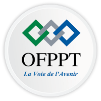

<!-- _class: cover -->

 

# Define

## Design Thinking

**Comprendre et définir le problème de l'utilisateur**

**Réalisée par :** Ranya Amzghar  
**Encadrant :** Es-sarraj Fouad
<!-- Aujourd'hui, je vais vous présenter l'étape Define du Design Thinking. -->

---

<!-- _class: light -->

1. Définition de l'étape Define
2. Les techniques de Define
   - Insights
   - Affinity Diagram
   - Point of View (POV)
   - Problem Statement
   - How Might We (HMW)
3. Application pratique : News Application
<!-- Voici, le plan de cette présentation -->
---

# 1. Qu'est-ce que Define ?

**Define** est une étape de Design Thinking.

Elle permet de :

- Comprendre les difficultés des utilisateurs.
- Identifier leurs problèmes.
- Trouver leurs vrais besoins.
- Formuler le problème clairement.

<!-- Define sert à comprendre les problèmes et les besoins des utilisateurs. -->

---

# 2. Les techniques

Pour définir correctement le problème, nous utilisons plusieurs techniques :

| Technique | Son objectif |
|---|---|
| **Insights** | Comprendre les besoins cachés. |
| **Affinity Diagram** | Organiser les informations par thèmes. |
| **POV** | Définir le besoin de l'utilisateur. |
| **Problem Statement** | Décrire clairement le problème. |
| **HMW** | Transformer le problème en question. |

<!-- Dans cette étape, voici les techniques pour mieux comprendre les utilisateurs et définir leur problème. -->

---

# 3. Insights

Un **Insight** est une information importante qui nous aide à comprendre le problème.

### Exemple : News Application

**Observation :** Les utilisateurs consultent plusieurs sites pour lire les actualités.

**Insight :** Ils ont besoin d'un accès simple et organisé aux informations.

<!-- Un insight nous aide à comprendre le vrai besoin derrière un problème. -->
---

# 4. Affinity Diagram

Un **Affinity Diagram** est une technique qui permet de regrouper les informations similaires dans différentes catégories.

### Comment le réaliser ?

- Collecter les observations et les idées.
- Regrouper les informations similaires.
- Donner un titre à chaque groupe.
- Identifier les thèmes principaux.

---

# 5. Point of View (POV)

Le **POV** décrit le problème du point de vue de l'utilisateur.

### Sa formule

- Utilisateur
- Besoin
- Raison du besoin

### Exemple

> Les personnes qui suivent l'actualité ont besoin d'un moyen simple pour trouver les nouvelles, car les informations sont dispersées sur plusieurs sites.

<!-- Le POV explique qui est l'utilisateur, son besoin et pourquoi il a ce besoin. -->
---

# 6. Problem Statement

Le **Problem Statement** est une phrase qui explique clairement le problème.
### Sa formule:

**[Qui]** rencontre **[quel problème]** lorsque **[situation]**, ce qui entraîne **[conséquence]**

### Exemple 

>Les utilisateurs ont des difficultés à trouver les actualités lorsque les informations sont dispersées sur plusieurs sites, ce qui leur fait perdre du temps.

**objectif :** donner une direction claire pour résoudre le problème.
<!-- Le Problem Statement décrit le problème, la situation dans laquelle il apparaît et ses conséquences. -->
---

# 7. How Might We (HMW) ?

**HMW** signifie « How Might We? », en français « Comment pourrions-nous ? ».

C'est une question qui transforme un problème en une opportunité de rechercher des idées et des solutions.
### Sa formule

> **Comment pourrions-nous + aider l'utilisateur + répondre à son besoin ?**

### Exemple : News Application

**Problème :**

Les utilisateurs perdent du temps à chercher les actualités sur plusieurs sites.

**HMW :**

> Comment pourrions-nous aider les utilisateurs à trouver facilement les dernières actualités dans un seul endroit ?
<!-- HMW transforme le problème en une question pour chercher des solutions. -->
---

# 8. Pratique : News Application

Maintenant, appliquons les techniques de Define à notre projet **News Application**.

### Objectif de l'application

- Afficher les dernières actualités.
- Organiser les actualités par catégories.
- Faciliter la recherche d'informations.
- Permettre une consultation simple et rapide.

### Situation étudiée

Imaginons que nous avons interrogé des personnes qui suivent régulièrement l'actualité.

---

**Exemples d'observations :**

- Elles visitent plusieurs sites pour lire les actualités.
- Elles ont du mal à trouver certaines informations.
- Elles cherchent les actualités par sujet.
- Elles perdent du temps à changer de site.

### Insights identifiés

| Observation | Insight |
|---|---|
| Plusieurs sites à consulter | Besoin d'un accès centralisé. |
| Difficulté à trouver des informations | Besoin d'une recherche simple. |
| Actualités sur différents sujets | Besoin d'une bonne organisation. |

---

## Diagramme d'affinités 

Organisons les observations des utilisateurs selon leurs similitudes :

  

    <h3>Navigation</h3>
    
Navigation difficile

    
Trop de temps pour chercher

  

  

    <h3>Organisation</h3>
    
Actualités mal organisées

    
Difficulté à trouver ses sujets préférés

  

  

    <h3>Expérience utilisateur</h3>
    
Trop de publicités

  

  

    <h3>Accessibilité</h3>
    
Accès rapide aux dernières actualités

  

---

# POV

Après l'analyse des informations, nous pouvons définir le besoin de l'utilisateur.

### Notre POV

> Les personnes qui suivent l'actualité ont besoin d'une plateforme simple et organisée parce que les informations sont dispersées sur plusieurs sites.

### Décomposition

| Élément | Notre projet |
|---|---|
| Utilisateur | Personnes qui suivent l'actualité |
| Besoin | Trouver les actualités facilement |
| Raison | Les informations sont dispersées |

---

# Problem Statement

> Les utilisateurs ont des difficultés à trouver les actualités lorsque les informations sont dispersées sur plusieurs sites, ce qui leur fait perdre du temps.

### Décomposition

| Élément | Notre projet |
|---|---|
| Qui ? | Les utilisateurs |
| Problème ? | Difficulté à trouver les actualités |
| Situation ? | Informations dispersées sur plusieurs sites |
| Impact ? | Perte de temps |

---

# How Might We ?

À partir de notre Problem Statement, nous transformons le problème en une question.

### HMW

> Comment pourrions-nous aider les utilisateurs à trouver facilement les dernières actualités dans un seul endroit ?

### Pourquoi cette question ?

- Elle se concentre sur le besoin de l'utilisateur.
- Elle ouvre plusieurs possibilités de solutions.
- Elle encourage la créativité de l'équipe.

---

# 9. Résultat final de Define

Voici le résultat de l'application des techniques de Define à notre projet.

| Élément | Résultat |
|---|---|
| **Insight** | Besoin d'informations centralisées et organisées. |
| **Affinity Diagram** | Accès, recherche et organisation. |
| **POV** | Les utilisateurs ont besoin d'une plateforme simple et organisée. |
| **Problem Statement** | Les utilisateurs perdent du temps à chercher les actualités sur plusieurs sites. |
| **HMW** | Comment faciliter l'accès aux dernières actualités dans un seul endroit ? |

---

# Conclusion

Define permet de :

- Comprendre les utilisateurs.
- Identifier leurs besoins.
- Trouver le problème principal.
- Formuler une problématique claire.
- Préparer la recherche de solutions.

<!-- Define nous aide à comprendre les utilisateurs et à identifier leur vrai problème. -->
---

# Merci pour votre attention.
