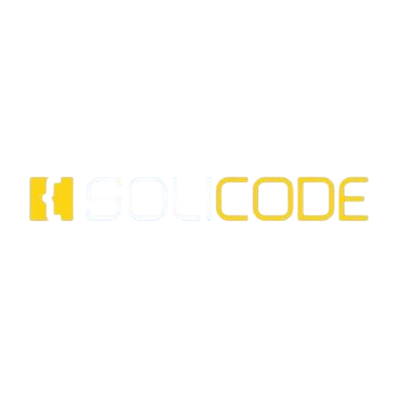
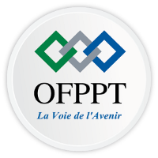

<!-- _class: cover -->

 

# Prototype

**Transformer les idées en solutions concrètes et testables**

**Réalisée par :** Ranya Amzghar  
**Encadrant :** Essarraj Fouad
<!-- Aujourd'hui, je vais vous présenter l'étape Prototype du Design Thinking. -->

---

<!-- _class: light -->

# Plan

- Prototype et son objectif
- Niveaux de fidélité : Low-Fidelity vs High-Fidelity
- Méthodes et outils : Papier, Wireframes et Prototype interactif
- Exemple : News Application
<!-- Voici le plan de cette présentation -->

---

# 1. Qu'est-ce que Prototype ?

**Prototype** est la quatrième étape du Design Thinking.

Elle permet de :

- Donner une forme concrète aux idées retenues.
- Rendre les solutions visibles et manipulables.
- Tester rapidement les concepts avec les utilisateurs.
- Identifier ce qui fonctionne et ce qui doit être corrigé.

<!-- Prototype permet de transformer nos idées en une version concrète et testable. -->

---

# 2. Objectif du Prototypage

- Matérialiser la solution rapidement et à faible coût.
- Vérifier si l'idée répond au besoin de l'utilisateur.
- Détecter les erreurs dès le début (*Fail fast, learn fast*).
- Améliorer le produit grâce aux retours concrets.

<!-- L'objectif du prototypage est de tester vite sans investir trop de temps ni de budget. -->

---

# 3. Niveaux de fidélité

| Niveau | Caractéristiques | Avantages |
| :--- | :--- | :--- |
| **Basse fidélité (Low-Fi)** | Croquis papier, schémas simples | Rapide, peu coûteux, retours francs |
| **Haute fidélité (High-Fi)** | Maquettes interactives, design soigné | Proche du produit final, teste l'ergonomie |

**Règle d'or :** Commencer toujours par la basse fidélité avant de créer un prototype détaillé.

<!-- Nous distinguons les prototypes basse fidélité et haute fidélité selon le niveau de détail. -->

---

# 4. Prototypage papier (Paper Prototype)

Le **Paper Prototype** consiste à dessiner les écrans de l'application sur papier.

### Exemple : News Application

- **Écran 1 :** Page d'accueil avec les catégories d'actualités.
- **Écran 2 :** Liste des articles récents sous forme de cartes.
- **Écran 3 :** Vue détaillée pour lire un article complet.

**Son rôle :** Valider l'organisation générale des écrans en quelques minutes.

<!-- Le prototype papier permet de dessiner les écrans à la main pour valider la disposition. -->

---

# 5. Wireframes

Le **Wireframe** est un schéma numérique en noir et blanc représentant la structure de la page.

### Sa composition

- Emplacement des zones de contenu (titres, images, textes).
- Disposition des éléments de navigation (menus, boutons).
- Sans couleurs ni styles graphiques définitifs.

### Exemple : News Application

> Une structure claire avec une barre de recherche en haut, le fil d'actualités au centre et un menu de navigation en bas.

<!-- Le wireframe fixe l'architecture et les zones de contenu sans se soucier du design visuel. -->

---

# 6. Prototype interactif

Le **Prototype interactif** simule l'utilisation réelle de l'application.

### Exemple : News Application

- Cliquer sur un thème filtre instantanément les articles.
- Cliquer sur un titre ouvre la page de lecture complète.
- Cliquer sur "Favoris" enregistre l'article pour plus tard.

**Son rôle :** Tester les interactions réelles et le parcours de l'utilisateur.

<!-- Le prototype interactif permet à l'utilisateur de cliquer et de naviguer comme dans une vraie application. -->

---

# 7. Tester et recueillir les retours

Le prototype est conçu pour être mis entre les mains de l'utilisateur.

### Ce que l'on observe

- **Compréhension :** L'utilisateur comprend-il la navigation immédiatement ?
- **Efficacité :** Trouve-t-il l'actualité recherchée rapidement ?
- **Difficultés :** Où hésite-t-il ou clique-t-il par erreur ?

**Son rôle :** Récolter des retours précis pour affiner et améliorer la solution.

<!-- Observer l'utilisateur sur le prototype nous aide à identifier ses blocages et à perfectionner la solution. -->

---

# 8. Exemple pratique

## News Application

- **Idée retenue :** Un espace unique regroupant toutes les actualités par thème.
- **Étape Papier :** Croquis rapides des trois écrans clés.
- **Étape Wireframe :** Structure numérique de la grille d'articles et des filtres.
- **Étape Interactive :** Maquette cliquable permettant de simuler la recherche et la lecture.

<!-- Cet exemple montre l'évolution du prototype depuis le croquis jusqu'à la maquette cliquable. -->

---

# 9. Résultat de Prototype

**Maquette concrète et testable :**  
Une version interactive qui illustre fidèlement le parcours utilisateur.

**Validation du parcours :**  
L'utilisateur accède aux actualités en moins de trois clics.

**Préparation au Test :**  
Une liste claire des points à valider lors de l'étape suivante (Test).

<!-- À la fin du prototypage, nous disposons d'une version concrète prête pour les tests utilisateurs. -->

---

# Conclusion

Prototype permet de :

- Rendre les idées tangibles et compréhensibles par tous.
- Échouer tôt pour réussir plus rapidement.
- Valider les choix de conception sans écrire une ligne de code.
- Gagner du temps et économiser les ressources de développement.
- Préparer la phase finale de Test.

<!-- Le prototypage permet de concrétiser les idées et d'apprendre rapidement avant le développement. -->

---

# Merci

Merci pour votre attention.

**Prototype : donner forme aux idées pour apprendre et progresser rapidement.**

