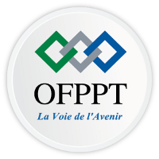

<!-- _class: cover -->

 

# Define

## Design Thinking

**Comprendre le problème de l'utilisateur**

**Réalisée par :** Ranya Amzghar  
**Encadrant :** Essarraj Fouad
<!-- Aujourd'hui, je vais vous présenter l'étape Define du Design Thinking. -->

---

<!-- _class: light -->

# Plan

- Define et son objectif
- Comprendre les utilisateurs et leurs besoins
- Insights, POV, Problem Statement et HMW
- Exemple : News Application
<!-- Voici, le plan de cette présentation -->
---

# 1. Qu'est-ce que Define ?

**Define** est une étape de Design Thinking.

Elle permet de :

- Comprendre les utilisateurs.
- Identifier leurs problèmes.
- Trouver leurs vrais besoins.
- Formuler le problème clairement.

<!-- Define sert à comprendre les problèmes et les besoins des utilisateurs. -->

---

# 2. Objectif de Define

- Identifier le problème principal.
- Comprendre les besoins des utilisateurs.
- Organiser les informations.
- Écrire une problématique claire.

<!-- L'objectif de Define est de trouver le problème principal et de le décrire clairement. -->
---

# 3. Comprendre les utilisateurs

**Qui ?** Qui utilise l'application ?  
**Quel problème ?** Quelle difficulté rencontre-t-il ?  
**Quel besoin ?** De quoi a-t-il besoin ?

### Exemple : News Application

- **Qui ?** Les personnes qui suivent l'actualité.
- **Problème ?** Les informations sont sur plusieurs sites.
- **Besoin ?** Trouver les actualités facilement.
<!-- Nous devons connaître les utilisateurs, leurs problèmes et leurs besoins. -->
---

# 4. Insights

Un **Insight** est une information importante qui nous aide à comprendre le problème.

### Exemple : News Application

**Observation :** Les utilisateurs consultent plusieurs sites pour lire les actualités.

**Insight :** Ils ont besoin d'un accès simple et organisé aux informations.

<!-- Un insight nous aide à comprendre le vrai besoin derrière un problème. -->
---

# 5. Point of View (POV)

Le **POV** décrit le problème du point de vue de l'utilisateur.

### Sa formule

- Utilisateur
- Besoin
- Raison du besoin

### Exemple

> Les personnes qui suivent l'actualité ont besoin d'un moyen simple pour trouver les nouvelles, car les informations sont dispersées sur plusieurs sites.

<!-- Le POV explique qui est l'utilisateur, son besoin et pourquoi il a ce besoin. -->
---

# 6. Problem Statement

Le **Problem Statement** est une phrase qui explique clairement le problème.

### Exemple : News Application

> Les utilisateurs ont du mal à trouver rapidement les actualités, car les informations sont disponibles sur plusieurs sites. Cela leur fait perdre du temps.

**Son rôle :** donner une direction claire pour résoudre le problème.
<!-- Le Problem Statement décrit clairement le problème que nous voulons résoudre. -->
---

# 7. How Might We (HMW) ?

**HMW** signifie « How Might We? », en français « Comment pourrions-nous ? ».

Cette question transforme un problème en possibilité de trouver des idées.

**Problème :** Les utilisateurs perdent du temps à chercher les actualités sur plusieurs sites.

**HMW :** « Comment pourrions-nous aider les utilisateurs à trouver facilement les dernières actualités ? »
<!-- HMW transforme le problème en une question pour chercher des solutions. -->
---

# 8. Exemple pratique

## News Application

- **Utilisateur :** les personnes qui veulent suivre l'actualité.
- **Problème :** les informations sont dispersées sur plusieurs sites.
- **Besoin :** trouver les actualités facilement et rapidement.
- **Insight :** les utilisateurs ont besoin d'informations simples et bien organisées.
<!-- Les utilisateurs ont besoin d'un endroit simple pour trouver les actualités rapidement. -->
---

# 9. Résultat de Define

**POV :**  
Les utilisateurs ont besoin d'un moyen simple pour trouver les actualités, car les informations sont dispersées sur plusieurs sites.

**Problem Statement :**  
Les utilisateurs perdent du temps à chercher les actualités sur différentes plateformes.

**HMW :**  
Comment pourrions-nous aider les utilisateurs à trouver les dernières actualités dans un seul endroit ?
<!-- À la fin de Define, nous avons un POV, un Problem Statement et une question HMW -->
---

# Conclusion

Define permet de :

- Comprendre les utilisateurs.
- Identifier leurs besoins.
- Trouver le problème principal.
- Formuler une problématique claire.
- Préparer la recherche de solutions.

<!-- Define nous aide à comprendre les utilisateurs et à identifier leur vrai problème. -->
---

# Merci

Merci pour votre attention.

**Define : comprendre le bon problème avant de chercher la bonne solution.**
