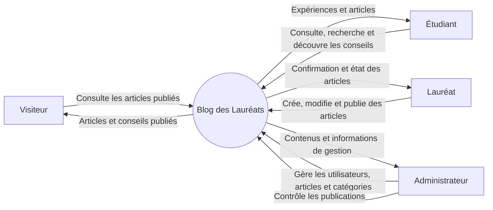

# Diagramme de contexte — Blog des Lauréats

> Cas pédagogique : le périmètre et les rôles sont issus du contexte fourni. Les échanges précis ci-dessous sont une représentation à valider avec les parties prenantes.

## Frontière du système

**Dans le système :** consultation et recherche d'articles, création/modification/publication d'articles par les lauréats, gestion des utilisateurs et catégories, contrôle des publications par l'administrateur.

**Acteurs externes :**

| Acteur | Interaction principale |
|---|---|
| Visiteur | Consulte les articles publiés. |
| Étudiant | Consulte les expériences, recherche des articles et découvre les conseils. |
| Lauréat | Crée, modifie et publie des articles. |
| Administrateur | Gère les utilisateurs, les articles et les catégories ; contrôle les publications. |

## Points à confirmer

- Un étudiant dispose-t-il d'un compte ou les mêmes fonctions sont-elles accessibles à tout visiteur ?
- La publication d'un lauréat est-elle immédiate ou soumise à une validation préalable ?
- Quelles opérations d'administration sont attendues pour chaque type de contenu ?
